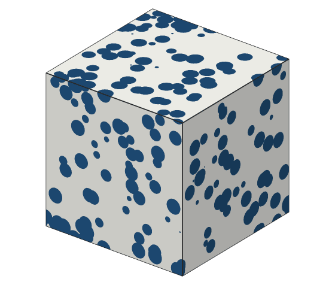
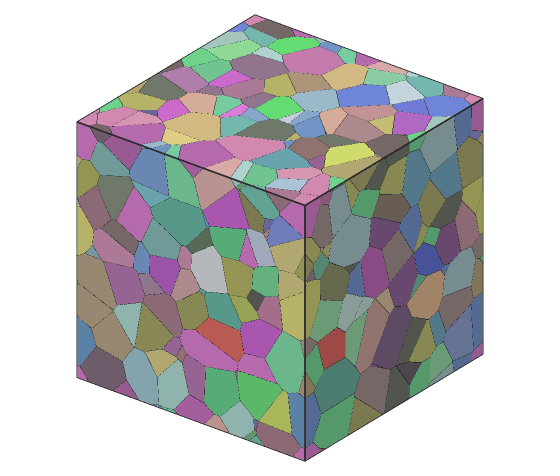
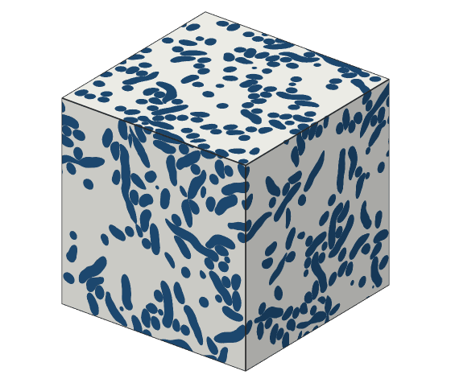
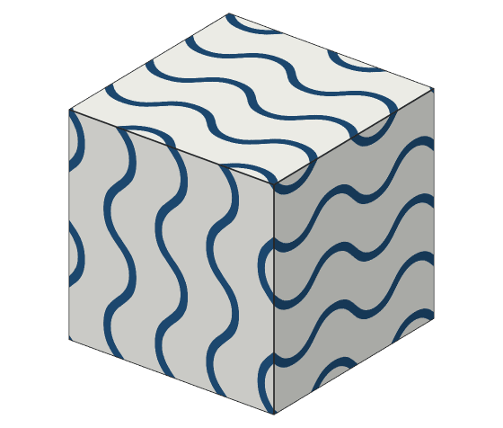
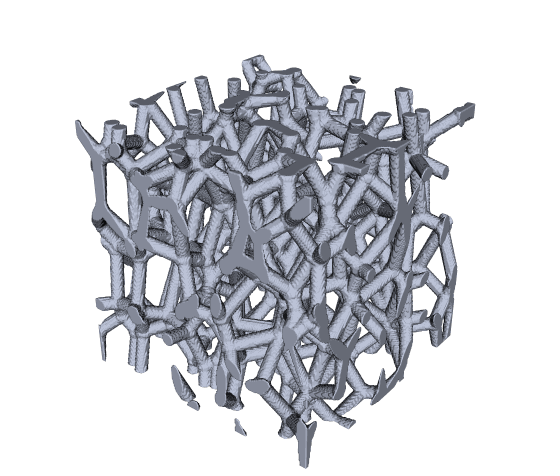
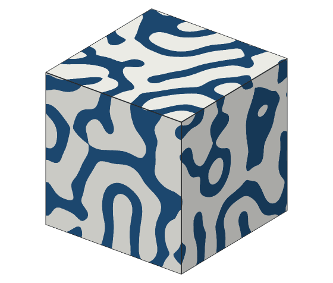

# morphoGen

[](https://pypi.org/project/morphogen/)
[](https://pypi.org/project/morphogen/)
[](https://github.com/jdirr/morphoGen/actions/workflows/ci.yml)
[](https://jdirr.github.io/morphoGen/)
[](https://doi.org/10.5281/zenodo.24340315)
[](https://github.com/jdirr/morphoGen/blob/main/LICENSE)

**Virtual microstructures for the mechanics and physics of materials.**

morphoGen generates random and architected media from models of mathematical morphology
and stochastic geometry, describes them exactly, measures them against theory, computes
their apparent properties up to their fracture, and tells how large a volume must be to
represent them. It is a Python package with a command line and a graphical interface in
the web browser.

<p align="center">
  
  
  
  
  
  
</p>

## What it does

A study follows one chain, and each step is a part of the package:

| Step | What morphoGen does |
|---|---|
| **Generate** | 46 models: Boolean models, packings, fibres, tessellations, Gaussian fields, dead leaves, automata and growths, spinodal decomposition, lattices, foams, triply periodic surfaces, woven textiles, bio-inspired structures, images segmented into their phases; monodisperse or polydisperse; periodic or not, combined, nested; and the shapes of Microgen (3MAH) |
| **Describe** | an exact description of each realization (centres, axes, cells) and an implicit function for each phase, from which voxel images, surfaces and conforming meshes are cut at any resolution |
| **Measure** | fractions, specific surface, covariance, chords, tortuosity, percolation thresholds, stereology..., each beside the closed form of its model when there is one; on the implicit geometry itself, exactly: the probes of mathematical morphology and the Minkowski functionals of unions of spheres; the model of an image or of a section identified among candidates |
| **Compute** | elastic, thermal, electrical, dielectric, magnetic and diffusive properties, their couplings, harmonic regimes, waves, flow and sound, thermo-chemo-elastic fields in time: finite elements on conforming meshes (by default), an FFT solver on voxels (CPU or GPU), extended finite elements |
| **Load** | plasticity, crystal plasticity, viscoelasticity, hyperelasticity, damage and MFront laws along loading paths, in small or finite strains; macroscopic laws identified, reduced or learned from the responses |
| **Break** | the phase field of fracture, cohesive zones, cracks of any front, ductile growth; contact and friction; high-cycle fatigue |
| **Size the RVE** | the statistics of Kanit et al. (2003): the variance against the volume, the integral range, the volume and the number of realizations for a precision |
| **Design** | topology optimization of periodic cells, the inverse design of active structures (4D: their shapes along a stimulus), compatible assemblies of building blocks, rigidity of lattices, isogeometric shape optimization |

Two application modules build on this chain: metal sheets architectured by localized
laser treatment (`morphogen.laser`) and explicit dynamics with OpenRadioss
(`morphogen.dynamics`). Meshes, images, behaviours and results go to Abaqus, CalculiX,
Code_Aster, OpenFOAM, AMITEX_FFTP, MFront, Z-set, Gmsh, Neper, DAMASK, FEniCSx and
ParaView; particles to the codes of discrete elements (LMGC90, LAMMPS, YADE), scenes to
Blender, voxel images to JAX and PyTorch, shapes to and from Microgen (3MAH); the
simulations to VIMSEO, for the demonstration of their credibility (verification,
validation, uncertainties).

## Installation

```bash
python -m pip install "morphogen[all]"
```

morphoGen needs Python 3.12 or newer, on Windows, macOS or Linux; every dependency comes
as a binary wheel. The [installation guide](https://jdirr.github.io/morphoGen/installation.html)
gives the environments, the installation from the sources and the optional components
(NVIDIA GPUs, the stand-alone application, OpenRadioss, MFront). Without Python, the
installers *morphoGen JupyterLab* of the [releases](https://github.com/jdirr/morphoGen/releases)
(Windows, macOS) install a Python of their own with morphoGen and JupyterLab.

## A first study

A model, a realization, its voxels, a measure against theory and three apparent
properties, in a second:

```python
import morphogen as mg
from morphogen.homogenization import Material, homogenize

model = mg.models.BooleanSpheres(radius=1.0, volume_fraction=0.3)
micro = model.generate(mg.Domain.cube(8.0, periodic=True), seed=1)  # centres and radii
image = micro.voxelize(shape=32)  # 32³ voxels: phase 0 (matrix), phase 1 (spheres)
theory = model.theory()
print(mg.analysis.volume_fraction(image), theory["volume_fraction"])  # 0.29 for 0.3

phases = {
    0: Material(young=3.0, poisson=0.35, conductivity=0.2),  # a polymer: GPa, W/(m K)
    1: Material(young=70.0, poisson=0.22, conductivity=1.0),  # glass
}
properties = ["bulk_modulus", "shear_modulus", "conductivity"]
out = homogenize(image, phases, properties=properties)
print({name: result.value for name, result in out.items()})  # 5.89, 2.59 (GPa), 0.33
```

The same from a configuration file, or from forms:

```bash
morphogen template homogenization_spheres -o study.yaml  # an example to start from
morphogen run study.yaml                                 # realizations and properties
morphogen gui                                            # the interface, in the browser
```

## Documentation

The documentation is online at [jdirr.github.io/morphoGen](https://jdirr.github.io/morphoGen/):

* the [tutorials](https://jdirr.github.io/morphoGen/tutorials.html) follow whole studies,
  and the [recipes](https://jdirr.github.io/morphoGen/howto.html) answer short questions;
* the [user guide](https://jdirr.github.io/morphoGen/guide.html) has a page for each step
  of a study, and the [gallery](https://jdirr.github.io/morphoGen/gallery.html) an example
  for each template;
* the [API reference](https://jdirr.github.io/morphoGen/api.html) documents the package,
  and the [theory notes](https://jdirr.github.io/morphoGen/theory.html) the formulas
  implemented and how they are checked.

## Citing

If morphoGen serves your work, please cite it by the DOI of all its versions,
[10.5281/zenodo.24340315](https://doi.org/10.5281/zenodo.24340315), with the papers of the
methods you use;
[CITATION.cff](https://github.com/jdirr/morphoGen/blob/main/CITATION.cff) and the page
[Citing morphoGen](https://jdirr.github.io/morphoGen/citing.html) give the reference.

## Contributing

Questions, bug reports and proposals are welcome as
[issues](https://github.com/jdirr/morphoGen/issues); changes go through pull requests
([CONTRIBUTING.md](https://github.com/jdirr/morphoGen/blob/main/CONTRIBUTING.md)).

## Licence

Copyright © 2026 Justin Dirrenberger. morphoGen is free software: you can redistribute
it and/or modify it under the terms of the GNU General Public License as published by the
Free Software Foundation, either version 3 of the License, or (at your option) any later
version. See [LICENSE](https://github.com/jdirr/morphoGen/blob/main/LICENSE).
