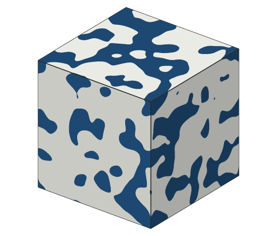
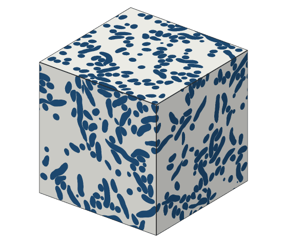
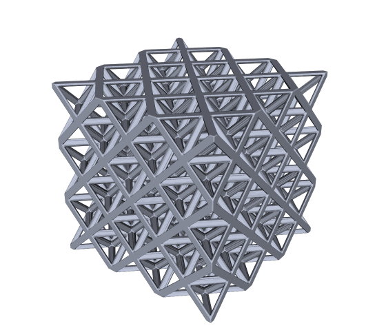
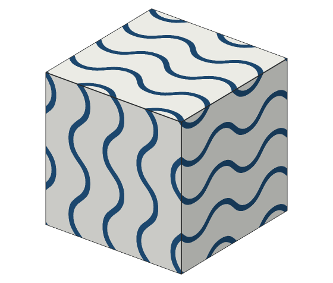
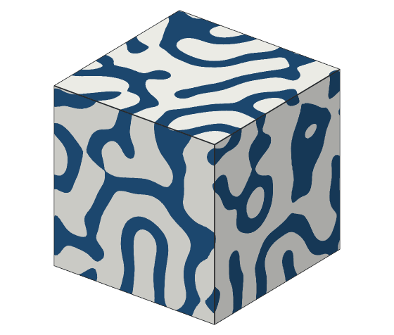

# morphoGen

:::::{container} hero

::::{container} hero-tagline
Virtual microstructures for the mechanics and physics of materials.
::::

::::{container} hero-text
morphoGen generates random and architected media from models of stochastic geometry,
describes them exactly, measures them against theory, computes their properties —
elastic, thermal, electrical, acoustic, nonlinear, up to their fracture — and tells how
large a volume must be to represent them. A Python package, a command line and a
graphical interface in the web browser; free software (GNU GPL v3 or later).
::::

::::{container} hero-buttons
[Get started](installation.md) [Tutorials](tutorials.md) [Gallery of examples](gallery.md)
[Recipes](howto.md)
::::

:::::

:::{container} strip
[](gallery.md#point-processes-and-boolean-models)
[](gallery.md#tessellations)
[](gallery.md#dead-leaves-gaussian-fields-and-reconstructions)
[](gallery.md#fibres-and-layers)
[](gallery.md#foams-and-lattices)
[](gallery.md#tpms)
[](gallery.md#bio-inspired)
[](gallery.md#automata-and-tilings)
:::

## What it does

:::::{container} cards

::::{container} card
**[Generate](gallery.md)**

40 models of random and architected media: Boolean models, packings, fibres,
tessellations, Gaussian fields, dead leaves, automata and growths, lattices, foams,
triply periodic surfaces, bio-inspired structures — periodic or not, combined, nested.
::::

::::{container} card
**[Grow](gallery.md#automata-and-tilings)**

Cellular automata and lattice processes: annealing and Turing patterns, reaction and
diffusion, nucleation and growth of grains, coarsening, fractal aggregates, on grids and
on quasi-periodic tilings.
::::

::::{container} card
**[Describe exactly](tutorial_geometry.md)**

A realization is a description (centres, axes, cells) with an implicit function for each
phase: sections, surfaces and conforming meshes are cut from it at any resolution, not
from voxels.
::::

::::{container} card
**[Measure](tutorial.md#3-characterize-it)**

Fractions, specific surface, covariance, chords, tortuosity, percolation thresholds,
stereology... each beside the closed form of its model when there is one.
::::

::::{container} card
**[Homogenize](physics.md)**

Elastic, thermal, electrical, dielectric, magnetic and diffusive properties, their weak
and strong couplings, harmonic regimes, waves, flow and sound: an FFT solver on voxels
(CPU or GPU), finite elements on conforming meshes, extended finite elements.
::::

::::{container} card
**[Follow behaviours](physics.md#6-nonlinear-behaviours)**

Plasticity, crystal plasticity, viscoelasticity, hyperelasticity, damage and MFront laws
along loading paths, in small or finite strains; reduced and learned models of the
responses.
::::

::::{container} card
**[Break](physics.md#7-fracture)**

Cracks of any surface and front, cohesive zones, ductile damage, and the phase field of
fracture on voxel images, from brittle composites to rubbers that tear.
::::

::::{container} card
**[Size the representative volume](tutorial_rve.md)**

The statistics of Kanit et al. (2003) for every property: the variance against the
volume, the integral range, the volume and the number of realizations for a precision.
::::

::::{container} card
**[Design](gallery.md#topology-optimization)**

Periodic cells optimized for their homogenized properties, compatible assemblies of
building blocks, lattices with defects and their rigidity; shapes optimized on their
exact geometry ([isogeometric analysis](tutorial_iga.md)).
::::

::::{container} card
**[Architecture metal sheets](laser.md)**

Localized laser treatments: the thermal cycles of the tracks, the phases they leave, the
tensile test of the specimen, the path optimized for strength and ductility.
::::

::::{container} card
**[Exchange](howto.md#other-codes)**

Meshes, images, behaviours and results for Abaqus and CalculiX, AMITEX_FFTP, MFront,
Z-set, Gmsh, Neper, DAMASK, FEniCSx and ParaView.
::::

::::{container} card
**[Work your way](tutorial_interface.md)**

Python functions, configuration files run from the command line (in parallel, on
clusters), or forms in the browser: the same computations, the same files.
::::

:::::

## A first study

A model, a realization, its voxels, a measure against theory and three apparent
properties, in a second:

```python
import morphogen as mg
from morphogen.homogenization import Material, homogenize

model = mg.models.BooleanSpheres(radius=1.0, volume_fraction=0.3)
micro = model.generate(mg.Domain.cube(8.0, periodic=True), seed=1)  # centres and radii
image = micro.voxelize(shape=32)  # 32³ voxels: phase 0 (matrix), phase 1 (spheres)
theory = model.theory()
print(mg.analysis.volume_fraction(image), theory["volume_fraction"])  # 0.29 for 0.3

phases = {
    0: Material(young=3.0, poisson=0.35, conductivity=0.2),  # a polymer: GPa, W/(m K)
    1: Material(young=70.0, poisson=0.22, conductivity=1.0),  # glass
}
properties = ["bulk_modulus", "shear_modulus", "conductivity"]
out = homogenize(image, phases, properties=properties)
print({name: result.value for name, result in out.items()})  # 5.89, 2.59 (GPa), 0.33
```

The same from a configuration file, or from forms:

```bash
morphogen template homogenization_spheres -o study.yaml  # an example to start from
morphogen run study.yaml                                 # realizations and properties
morphogen gui                                            # the interface, in the browser
```

## Find your way

| To... | read |
|---|---|
| install morphoGen | [Installation](installation.md) |
| learn it by a study | the [tutorials](tutorials.md): a whole study, the size of the representative volume, a rubber, exact geometry, isogeometric analysis, the interface |
| get a quick answer | the [recipes](howto.md) and the [questions and troubles](faq.md) |
| know what is computed, and by which solver | the [guide to the physics](physics.md) |
| start from an example | the [gallery](gallery.md): a card per template, with its image and its configuration |
| find an option of the command line, of a configuration or of the interface | the [guide](guide.md) |
| read the formulas and how they were checked | the [theory notes](theory.md) |
| look up a function or a class | the [API reference](api.md) |
| check what a word means here | the [glossary](glossary.md) |
| see what changed | the [change log](changelog.md) |

## In detail

```{include} ../README.md
:start-after: <!-- section: introduction -->
:end-before: <!-- section: features -->
:relative-docs: docs/
```

```{toctree}
:caption: Start
:maxdepth: 2
:hidden:

installation
tutorials
Recipes <howto>
faq
```

```{toctree}
:caption: Guide
:maxdepth: 2
:hidden:

features
Guide to the physics <physics>
User guide <guide>
gallery
Laser-architectured sheets <laser>
laser_materials
performance
```

```{toctree}
:caption: Reference
:maxdepth: 2
:hidden:

Theory notes <theory>
Z-mat material files <zmat>
api
glossary
stability
```

```{toctree}
:caption: Project
:maxdepth: 1
:hidden:

citing
changelog
development
release
architecture
specification
references
licence
```
