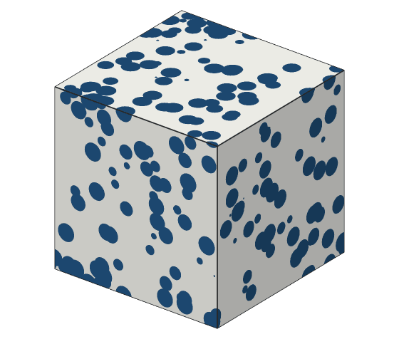
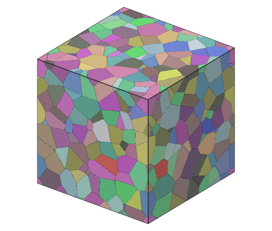
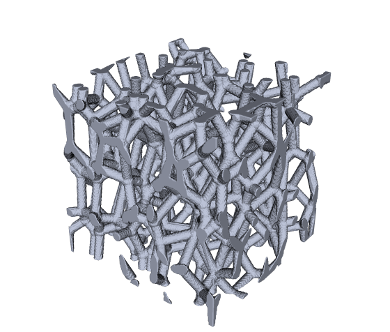

# morphoGen

:::::{container} hero

::::{container} hero-tagline
Virtual microstructures for the mechanics and physics of materials.
::::

::::{container} hero-text
morphoGen generates random and architected media from models of stochastic geometry,
describes them exactly, measures them against theory, computes their properties up to
their fracture, and tells how large a volume must be to represent them. A Python
package, a command line and a graphical interface in the web browser; free software
(GNU GPL v3 or later).
::::

::::{container} hero-buttons
[Get started](installation.md) [Tutorials](tutorials.md) [User guide](guide.md)
[Gallery of examples](gallery.md)
::::

:::::

:::{container} strip
[](gallery.md#point-processes-and-boolean-models)
[](gallery.md#tessellations)
[](gallery.md#dead-leaves-gaussian-fields-and-reconstructions)
[](gallery.md#fibres-and-layers)
[](gallery.md#foams-and-lattices)
[](gallery.md#tpms)
[](gallery.md#bio-inspired)
[](gallery.md#automata-and-tilings)
:::

## The steps of a study

:::::{container} cards

::::{container} card
**[Generate](models.md)**

40 models of random and architected media: Boolean models, packings, fibres,
tessellations, Gaussian fields, dead leaves, automata and growths, lattices, foams,
triply periodic surfaces, bio-inspired structures; periodic or not, combined, nested.
::::

::::{container} card
**[Describe exactly](geometry.md)**

A realization is a description (centres, axes, cells) with an implicit function for each
phase: sections, surfaces and conforming meshes are cut from it at any resolution, not
from voxels.
::::

::::{container} card
**[Measure](measures.md)**

Fractions, specific surface, covariance, chords, tortuosity, percolation thresholds,
stereology, textures..., each beside the closed form of its model when there is one.
::::

::::{container} card
**[Compute properties](properties.md)**

Elastic, thermal, electrical, dielectric, magnetic and diffusive properties, their weak
and strong couplings, harmonic regimes, waves, flow and sound: an FFT solver on voxels
(CPU or GPU), finite elements on conforming meshes, extended finite elements.
::::

::::{container} card
**[Follow behaviours](behaviours.md)**

Plasticity, crystal plasticity, viscoelasticity, hyperelasticity, damage and MFront laws
along loading paths, in small or finite strains; macroscopic laws identified, reduced or
learned from the responses.
::::

::::{container} card
**[Break](fracture.md)**

The phase field of fracture on voxel images, cohesive zones, cracks of any surface and
front, ductile growth; contact, self-contact and friction; high-cycle fatigue.
::::

::::{container} card
**[Size the representative volume](rve.md)**

The statistics of Kanit et al. (2003) for every property: the variance against the
volume, the integral range, the volume and the number of realizations for a precision.
::::

::::{container} card
**[Design](design.md)**

Periodic cells optimized for their homogenized properties, compatible assemblies of
building blocks, lattices with defects and their rigidity, holes shaped on their exact
geometry, patterns after buckling.
::::

:::::

## Applications and tools

:::::{container} cards

::::{container} card
**[Architecture metal sheets](laser.md)**

Localized laser treatments: the thermal cycles of the tracks, the phases they leave, the
tensile test of the specimen, the path optimized for strength and ductility.
::::

::::{container} card
**[Crush and impact](dynamics.md)**

Explicit dynamics with OpenRadioss: the crushing, tension, shear and impact of a
morphology at the rates of crashes, shocks and drops.
::::

::::{container} card
**[Work your way](running.md)**

Python functions, configuration files run from the command line (in parallel, on
clusters), or the forms of the [graphical interface](interface.md): the same
computations, the same files.
::::

::::{container} card
**[Exchange](interop.md)**

Meshes, images, behaviours and results for Abaqus and CalculiX, AMITEX_FFTP, MFront,
Z-set, Gmsh, Neper, DAMASK, FEniCSx and ParaView.
::::

:::::

## A first study

A model, a realization, its voxels, a measure against theory and three apparent
properties, in a second:

```python
import morphogen as mg
from morphogen.homogenization import Material, homogenize

model = mg.models.BooleanSpheres(radius=1.0, volume_fraction=0.3)
micro = model.generate(mg.Domain.cube(8.0, periodic=True), seed=1)  # centres and radii
image = micro.voxelize(shape=32)  # 32³ voxels: phase 0 (matrix), phase 1 (spheres)
theory = model.theory()
print(mg.analysis.volume_fraction(image), theory["volume_fraction"])  # 0.29 for 0.3

phases = {
    0: Material(young=3.0, poisson=0.35, conductivity=0.2),  # a polymer: GPa, W/(m K)
    1: Material(young=70.0, poisson=0.22, conductivity=1.0),  # glass
}
properties = ["bulk_modulus", "shear_modulus", "conductivity"]
out = homogenize(image, phases, properties=properties)
print({name: result.value for name, result in out.items()})  # 5.89, 2.59 (GPa), 0.33
```

The same from a configuration file, or from forms:

```bash
morphogen template homogenization_spheres -o study.yaml  # an example to start from
morphogen run study.yaml                                 # realizations and properties
morphogen gui                                            # the interface, in the browser
```

## Where to go next

| To... | read |
|---|---|
| install morphoGen | [Installation](installation.md) |
| learn it by a study | the [tutorials](tutorials.md): a whole study, the size of the representative volume, a rubber, exact geometry, isogeometric analysis, contact and damage, fracture, textures, the interface |
| go through the steps of a study | the [user guide](guide.md), a page for each step |
| get a quick answer | the [recipes](howto.md) and the [questions and troubles](faq.md) |
| know what is computed, and by which solver | the [guide to the physics](physics.md) |
| start from an example | the [gallery](gallery.md): a card per template, with its image and its configuration |
| find a key of a configuration or a command | the [configuration reference](configuration.md) |
| look up a function or a class | the [API reference](api.md) |
| read the formulas and how they are checked | the [theory notes](theory.md) |
| check what a word means here | the [glossary](glossary.md) |
| see what changed | the [change log](changelog.md) |

```{toctree}
:caption: Getting started
:maxdepth: 2
:hidden:

installation
tutorials
Gallery of examples <gallery>
Recipes <howto>
faq
```

```{toctree}
:caption: User guide
:maxdepth: 2
:hidden:

Overview <guide>
models
geometry
measures
properties
Guide to the physics <physics>
behaviours
fracture
rve
design
```

```{toctree}
:caption: Applications
:maxdepth: 2
:hidden:

Laser-architectured sheets <laser>
dynamics
```

```{toctree}
:caption: Running studies
:maxdepth: 2
:hidden:

running
interface
interop
```

```{toctree}
:caption: Reference
:maxdepth: 2
:hidden:

api
configuration
Theory notes <theory>
Z-mat material files <zmat>
glossary
performance
```

```{toctree}
:caption: Project
:maxdepth: 1
:hidden:

citing
changelog
stability
development
release
architecture
Specification <specification>
references
licence
```
