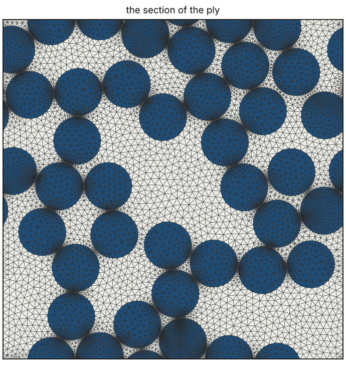

# Tutorial: fibre composites in their plane

A unidirectional composite — carbon fibres in epoxy, glass in polyester — does not vary
along its fibres: its section is its structure, and the finite elements of the plane solve
it there, the fibres meshed by their exact discs. This tutorial packs the fibres of a ply at
random, meshes their section, computes the stiffness and the conductivity of the composite
across and along its fibres, the permeability of the dry preform that the resin fills, and
meshes the section of misaligned fibres by their exact contours, and writes the mesh for
Abaqus. Each step meets what is known in advance: the axial
conductivity, the arithmetic mean of those of the phases; the connections of Hill, which
the uniform fields of fibre composites fix whatever their arrangement; the bounds of Hashin
and Shtrikman; a flow through the pores in one connected part.

The snippets follow each other in one session and take about half a minute in all.

## 1. The section of the fibres

Long straight fibres along $z$ cross the periodic box and close on themselves across it,
their sections a random packing grown to the fraction without overlap
([theory](theory.md), the long fibres). Their sections are discs, which the mesh of the
plane follows exactly: each circle discretized with its nodes on it, the elements graded
from the gaps between the fibres, three across the narrowest, the six-node triangles
curved along the circles ([theory](theory.md) §119):

```python
import numpy as np

import morphogen as mg
from morphogen.homogenization import Material, homogenize
from morphogen.models.long_fibers import LongFibers

model = LongFibers(radius=3.5, volume_fraction=0.55, arrangement="random", min_gap=0.2)
ply = model.generate(mg.Domain(size=(50.0, 50.0, 10.0), periodic=True), seed=1)  # micrometres
mesh = mg.mesh.plane_mesh(ply, size=1.0, order=2)
print(mesh.metadata["mesher"], mesh.metadata["discs"])  # exact discs (mmg2d) 36
print(round(mesh.phase_fractions()[1], 6), round(ply.summary()["volume_fraction"], 6))
# 0.554176 0.554177: the fraction of the fibres, to the curved edges
print(round(mesh.min_angles().min(), 1), mesh.matching_sides())  # 12.6 True

from morphogen.viz.figures import mesh_figure

fig = mesh_figure(mesh, title="the section of the ply")
fig.savefig("fibres_section.png", dpi=150)
```



## 2. The stiffness of the composite

The fields of a structure that does not vary along $z$ do not vary along $z$ either: in
generalized plane strain the finite elements of the plane give the whole stiffness of the
composite in space, its axial components among them ([theory](theory.md) §119). Carbon
fibres, isotropic here, in epoxy:

```python
epoxy = Material(young=3.5, poisson=0.35, conductivity=0.2)  # GPa, W/m/K
carbon = Material(young=230.0, poisson=0.2, conductivity=10.0)
materials = {0: epoxy, 1: carbon}
out = homogenize(mesh, materials, bcs=["kubc", "periodic", "subc"],
                 properties=["stiffness", "conductivity_tensor"])
for bc in ("kubc", "periodic", "subc"):
    c = out[f"stiffness.{bc}"]
    print(bc, round(c["E3"], 2), round(c["E1"], 2), round(c["E2"], 2))
# kubc 129.1 23.94 20.27
# periodic 129.07 16.42 15.44
# subc 129.06 14.61 14.25
```

Along the fibres the composite is nearly the rule of mixtures, $c E_f + (1 - c) E_m$ = 129.02:
the fibres and the matrix strain alike, but for the mismatch of their Poisson's ratios.
Across them it is a tenth of that, and the conditions on the sides of a window of 36 fibres
still part: kinematic above periodic above static, the transverse moduli 6 % apart along
$x$ and $y$ — the window is small.

What the arrangement of the fibres cannot change is what a uniform field fixes. A strain
$a$ across the plane and $b$ along the fibres with $a/b = -(\lambda_f - \lambda_m) / (2(k_f -
k_m))$, $k = \lambda + \mu$, gives both phases the same transverse stress: the uniform strain
is then the field itself, whatever the arrangement, and the composite answers with that
stress (Hill 1964). The elements hold the uniform fields, and give it to round-off:

```python
def lame(m):
    lam = m.young * m.poisson / ((1 + m.poisson) * (1 - 2 * m.poisson))
    return lam, lam + m.young / (2 * (1 + m.poisson))  # lambda, k

(lm, km), (lf, kf) = lame(epoxy), lame(carbon)
b = 1.0
a = -(lf - lm) / (2 * (kf - km)) * b
stress = out["stiffness.periodic"]["tensor"] @ np.array([a, a, b, 0, 0, 0])
print(abs(stress[0] / (2 * km * a + lm * b) - 1) < 1e-12)  # True: Hill's connection
```

The transverse bulk modulus of the composite, `k23 = (C11 + C22 + 2 C12) / 4`, lies between
the bounds of Hashin and Shtrikman, near the lower one: the fibres are separate, the matrix
continuous about them (the assemblage of coated cylinders reaches it):

```python
c = mesh.phase_fractions()[1]
mm, mf = epoxy.young / (2 * (1 + epoxy.poisson)), carbon.young / (2 * (1 + carbon.poisson))
lower = km + c / (1 / (kf - km) + (1 - c) / (km + mm))
upper = kf + (1 - c) / (1 / (km - kf) + c / (kf + mf))
C = out["stiffness.periodic"]["tensor"]
k23 = 0.25 * (C[0, 0] + C[1, 1] + 2 * C[0, 1])
print(round(lower, 2), round(k23, 2), round(upper, 2))  # 10.78 13.09 55.23
```

## 3. The conduction of heat

Along the fibres the heat flows through both phases side by side: the axial conductivity is
the arithmetic mean of theirs, under every condition. Across them it flows through the
matrix about the fibres, above the lower bound of Hashin and Shtrikman (that of the matrix
continuous):

```python
for bc in ("kubc", "periodic", "subc"):
    print(bc, np.round(np.diag(out[f"conductivity_tensor.{bc}"]["tensor"]), 3))
# kubc [1.387 1.177 5.631]
# periodic [0.979 0.926 5.631]
# subc [0.853 0.865 5.631]
print(round(c * 10.0 + (1 - c) * 0.2, 3))  # 5.631
print(round(0.2 * (1 + c * 9.8 / (0.2 + (1 - c) * 9.8 / 2)), 3))  # 0.656: the lower bound
```

## 4. The permeability of the dry preform

Before the resin fills it, the ply is a bed of fibres whose pores the resin creeps through
(infusion, resin transfer moulding): their permeability is that of the Stokes flow across
the fibres and of its flow along them, by the elements of Taylor and Hood on the triangles of
the pores ([theory](theory.md) §120). The pores replace the matrix:

```python
from morphogen.homogenization import plane_permeability

preform = plane_permeability(mesh, {0: Material(void=True), 1: carbon})
print(preform["parts"], round(preform["porosity"], 4))  # 1 0.4458: the pores in one part
print([round(preform[k], 4) for k in ("k11", "k22", "k33")])  # [0.0024, 0.0034, 1.6073]
```

The permeabilities are in squared micrometres. Along the fibres the resin flows five hundred
times more easily than across them: across, it passes through the narrowest gaps between
the fibres — 0.2 micrometre at the least —, and a random packing has gaps far narrower than
those of the hexagonal array of the same fraction, whose transverse permeability Gebart's
formula gives as 0.117: forty times more.

## 5. Misaligned fibres

The fibres of real plies wave about their axis by a few degrees (Yurgartis 1987):
`misalignment` gives the RMS angle of their segments to $z$, chains of spherocylinders in a
box long enough for their waviness ([theory](theory.md), the long fibres). Their sections
are no longer discs: the mesh of the plane traces their contours fibre by fibre, each on its
own distance function, so that no gap between two fibres closes, however narrow
([theory](theory.md) §119, the exact contours):

```python
long_box = mg.Domain(size=(50.0, 50.0, 200.0), periodic=True)  # long enough to wave
wavy = LongFibers(radius=3.5, volume_fraction=0.55, arrangement="random", min_gap=0.2,
                  misalignment=3.0).generate(long_box, seed=1)
print(round(wavy.summary()["misalignment_rms"], 2))  # 3.04 degrees
section = mg.mesh.plane_mesh(wavy, size=1.0, order=2)
print(section.metadata["mesher"], section.metadata["bodies"])  # exact contours (mmg2d) 46
wet = plane_permeability(section, {0: Material(void=True), 1: carbon})
print(wet["parts"], [round(wet[k], 4) for k in ("k11", "k22")])  # 1 [0.0127, 0.0079]
```

The 46 sections are those of the 36 fibres and of their images across the sides. The level
sets of the whole section (`mg.mesh.triangles.section_mesh`) join fibres across the
narrowest gaps, even at 0.2 micrometre: at the same size their pores fall into 9 parts, and
the transverse permeabilities to 0.0078 and 0.0025, the gaps that carry the flow closed. The
permeability along $z$ of the flows of the plane is that of straight fibres with this
section, not that of the waving fibres.

So is its axial modulus, that of straight fibres. Turned so that its axis follows each
segment of the fibres and averaged with their volumes, the stiffness of the section bounds
that of the ply, the composite aligned with each segment about it (Hill 1952): Voigt above,
Reuss below ([theory](theory.md) §119, the axial stiffness of misaligned plies):

```python
from morphogen.homogenization.postprocess import engineering_constants
from morphogen.homogenization.unidirectional import fibre_directions, misaligned_stiffness

aligned = homogenize(section, materials, properties=["stiffness"])
aligned = aligned["stiffness.periodic"]["tensor"]  # the section: fibres along z
directions, volumes = fibre_directions(wavy)  # those of the segments of the fibres
bounds = misaligned_stiffness(aligned, directions, volumes)
print(round(engineering_constants(aligned)["E3"], 1))  # 129.3: straight fibres
print([round(engineering_constants(bounds[k])["E3"], 1) for k in ("voigt", "reuss")])
# [128.5, 122.6]: three degrees of waviness cost up to 5 % of the axial modulus
```

The axial modulus that the FFT solver finds on the voxels of misaligned plies falls between
these bounds, as long as the voxels are fine enough to keep the gaps between the fibres
open. A run records them beside the stiffness of the section with `misaligned: true` among
the keys of its `homogenization` (the meshes of the plane, the stiffness among its
properties): `stiffness_voigt.<bc>.E3`, `stiffness_reuss.<bc>.E3`, `stiffness_layers.<bc>.E3`
and their other entries and engineering constants.

## 6. Files for other codes

The mesh of the section is written as plane elements: CPE6 in plane strain for Abaqus and
CalculiX, the fibres and the matrix as sets with their materials, and the periodic equations
that tie the nodes of opposite sides to two reference nodes:

```python
mg.io.save_mesh(mesh, "ply.inp", materials=materials)
mg.io.write_periodic_equations("ply_equations.inp", mesh)
print(open("ply.inp").read().count("*SOLID SECTION"))  # 2: the matrix and the fibres
```

The template `fibre_bed_plane` computes the permeability of preforms over several
realizations, and `misaligned_ply_plane` the transverse stiffness and conductivity of a
misaligned ply, and the bounds of its axial stiffness:

```bash
morphogen template fibre_bed_plane -o preform.yaml
morphogen run preform.yaml
morphogen template misaligned_ply_plane -o ply.yaml
morphogen run ply.yaml
```
