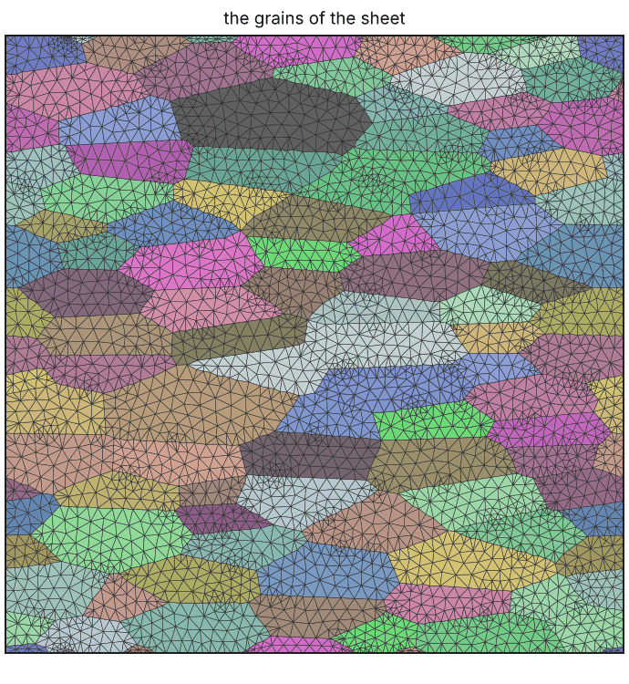

# Tutorial: polycrystals of the plane, meshed and solved in their plane

A structure that does not vary across a plane — grains that run through the thickness of a
sheet, the section of a polycrystal, the map of an acquisition (EBSD) — is studied in its
plane: meshed by triangles that follow its grains, and solved by the finite elements of the
plane, whose fields are those of the structure in space. This tutorial grows the grains of a
rolled sheet from elliptical seeds, meshes their exact polygons, computes the stiffness of
the sheet under the three uniform conditions, cuts a polycrystal of space by a plane, meshes
an orientation map by its pixels, pulls a sheet into the plastic regime and writes its mesh
for Abaqus. Each step meets a number known in advance: the bulk modulus of cubic crystals,
the area of the box, the ordering of the conditions.

The snippets follow each other in one session and take about a minute in all, most of it
the plastic path.

## 1. Grains of the plane and their exact polygons

Seeds of the plane (MicroStructPy's ellipses) grow columnar grains through the thickness of
the box: the Laguerre cells of the circles that fill each seed, gathered into its grain
([theory](theory.md), §117). Their sections are exact polygons — the power diagram of the
plane —, which the mesh of the plane follows:

```python
import numpy as np

import morphogen as mg
from morphogen.distributions import LogNormal
from morphogen.homogenization import Material, homogenize
from morphogen.models.seeded import SeededLaguerre

model = SeededLaguerre(dimension=2, diameter=LogNormal(0.12, 0.03), aspect_ratio=2.5,
                       orientation="aligned", crystal_orientations=True)
sheet = model.generate(mg.Domain(size=(1.0, 1.0, 0.05), periodic=True), seed=1)
print(sheet.n_grains)  # 90 grains, elongated along x as their seeds

exact = mg.mesh.plane_mesh(sheet, size=0.025, min_feature=0)  # the exact polygons
mesh = mg.mesh.plane_mesh(sheet, size=0.025)  # their features below size / 4 removed
print(exact.n_elements, round(exact.min_angles().min(), 1))  # 55714 2.9
print(mesh.n_elements, round(mesh.min_angles().min(), 1))  # 8742 9.0
print(round(mesh.areas().sum(), 12), mesh.matching_sides())  # 1.0 True
```

The exact polygons have small features — the short edges where the circles of two seeds
meet along a grain boundary, the thin caps of the cells that the sides of the box cut —,
and a mesh that keeps them all is six times finer, its smallest angles a few degrees. By
default, as for the cells in space,
the features smaller than a quarter of the elements are removed (`min_feature`): the short
edges collapse and the vertices near the sides move onto them. The grains keep their areas
within a few tenths of a percent, the box its area exactly, and the opposite sides of the
periodic box their matching nodes:

```python
areas = sheet.grain_shapes()["area"]
per_grain = np.bincount(mesh.cell, mesh.areas(), minlength=sheet.n_grains)
print(round(100 * np.mean(np.abs(per_grain - areas) / areas), 2))  # 0.49 % on average

from morphogen.viz.figures import mesh_figure

fig = mesh_figure(mesh, grains=True, title="the grains of the sheet")
fig.savefig("plane_grains.png", dpi=150)
```



## 2. The stiffness of the sheet

The fields of a structure that does not vary along z do not vary along z either: the
finite elements of the plane solve for a displacement of the plane, its three components,
and give the 6 x 6 stiffness of the sheet in space (generalized plane strain,
[theory](theory.md) §119). Crystals of copper, turned by the orientations of their grains:

```python
copper = {1: Material.cubic(168.4, 121.4, 75.4)}  # GPa
out = homogenize(mesh, copper, bcs=["kubc", "periodic", "subc"], properties=["stiffness"])
for bc in ("kubc", "periodic", "subc"):
    c = out[f"stiffness.{bc}"]
    print(bc, round(c["bulk_modulus"], 3), round(c["E1"], 1), round(c["E2"], 1))
# kubc 137.067 132.0 127.5
# periodic 137.067 130.3 125.4
# subc 137.067 128.1 123.5
```

The bulk modulus of cubic crystals, `(C11 + 2 C12) / 3`, comes out under every condition:
a uniform strain is a solution for any orientation. The kinematic conditions stiffen, the
static ones soften, the periodic ones lie between. The sheet is a little stiffer along its
grains (E1) than across them (E2).

In plane strain the anti-plane displacement is held at zero: the shears 13 and 23 cannot
relax, and the stiffness is higher there (`plane="strain"`). The problems of the plane are
those of a layer of tetrahedra in space, periodic across its thickness (`TriMesh.layer`):
the same tensor, to round-off — here on a coarser mesh, the problems in space being larger:

```python
strain = homogenize(mesh, copper, properties=["stiffness"], plane="strain")
generalized = out["stiffness.periodic"]["tensor"]
print(round(strain["stiffness.periodic"]["tensor"][3, 3] - generalized[3, 3], 2))  # 3.45 GPa

coarse = mg.mesh.plane_mesh(sheet, size=0.1)
plane = homogenize(coarse, copper, properties=["stiffness"])["stiffness.periodic"]
layer = homogenize(coarse.layer(), copper, properties=["stiffness"])["stiffness.periodic"]
print(float(np.abs(layer["tensor"] - plane["tensor"]).max()) < 1e-9 * 168.4)  # True
```

## 3. The section of a polycrystal of space

A plane cuts the cells of a Laguerre tessellation in space along a power diagram of the
plane: that of the germs projected on it, their weights less the squares of their distances
to the plane. `plane_mesh` meshes these exact sections — no voxels, no level set:

```python
grains = mg.models.Voronoi(n_cells=200, crystal_orientations=True).generate(
    mg.Domain.cube(1.0, periodic=True), seed=2
)
section = mg.mesh.plane_mesh(grains, size=0.02, z=0.5)  # the section at mid-height
print(len(np.unique(section.cell)), round(section.areas().sum(), 12))  # 42 1.0
cut = homogenize(section, copper, bcs=["periodic"], properties=["shear_modulus"])
print(round(cut["shear_modulus.periodic"].value, 1))  # 48.5 GPa
```

The section is a columnar polycrystal of its own: its stiffness is that of grains that run
through the thickness, not that of the polycrystal of space.

## 4. An orientation map

An orientation map (EBSD) is a lattice of points, each the label of a grain and the mean
orientation of its crystal. Its pixels are meshed as they are, two triangles each with the
grain and the orientation of its pixel — the map as measured. A window of the map is not
periodic: the kinematic and the static conditions bound its stiffness:

```python
from morphogen.models.ebsd import EBSD

window = EBSD(file="ebsd_map.ctf").generate(mg.Domain(size=(16.0, 12.0, 0.5), periodic=False),
                                            seed=1)
pixels = mg.mesh.plane_mesh(window, size=0.5)
print(pixels.n_elements, len(np.unique(pixels.cell)))  # 1536 20: 32 x 24 points, 20 grains
nickel = {1: Material.cubic(246.5, 147.3, 124.7)}
bounds = homogenize(pixels, nickel, bcs=["kubc", "subc"], properties=["stiffness"])
print(round(bounds["stiffness.kubc"]["E1"], 1), round(bounds["stiffness.subc"]["E1"], 1))
# 207.5 197.7
```

## 5. A plastic path

The nonlinear behaviours follow their loading paths on the layer of the mesh in space,
periodic across it — generalized plane strain still —, its tangents factorized. A sheet of
grains of two phases, soft ones that yield (0.7 of the area) about stiff ones, pulled along
x:

```python
from morphogen.homogenization import LoadingPath
from morphogen.homogenization.behaviours import Plasticity

two = SeededLaguerre(dimension=2, diameter=0.2, phase_fractions=[0.7, 0.3]).generate(
    mg.Domain(size=(1.0, 1.0, 0.05), periodic=True), seed=3
)
grains_of_two = mg.mesh.plane_mesh(two, size=0.1, order=2)
materials = {0: Material(young=70e3, poisson=0.3, plasticity=Plasticity(yield_stress=100.0,
                                                                        hardening=500.0)),
             1: Material(young=400e3, poisson=0.25)}
pull = LoadingPath.from_spec({"times": [0, 1], "increments": 5, "strain": {"11": 0.01}})
path = homogenize(grains_of_two, materials, properties=[], paths={"pull": pull})
print(round(path["pull.periodic"].components()["S11"], 1))  # 150.4 MPa at 1 % of strain
```

## 6. Files for other codes

The mesh of the plane is written as plane elements: CPE6 in plane strain for Abaqus and
CalculiX, with the sets of the grains and of the sides, each grain its own material, its
crystal turned into the axes of the box; the periodic equations tie the nodes of the
opposite sides to two reference nodes that carry the macroscopic strain:

```python
mg.io.save_mesh(mesh.quadratic(), "sheet.inp", materials=copper)
mg.io.write_periodic_equations("sheet_equations.inp", mesh.quadratic())
print(open("sheet.inp").read().count("*SOLID SECTION"))  # 90: a section per grain
```

The configuration of the template `seeded_plane_stiffness` runs the first two steps from a
file, and `ebsd_plane` the fourth on windows of the map:

```bash
morphogen template seeded_plane_stiffness -o sheet.yaml
morphogen run sheet.yaml
```
